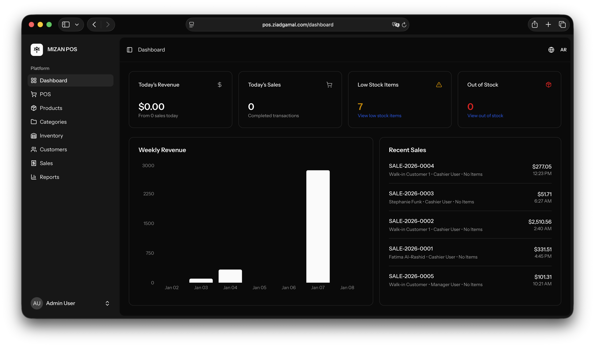
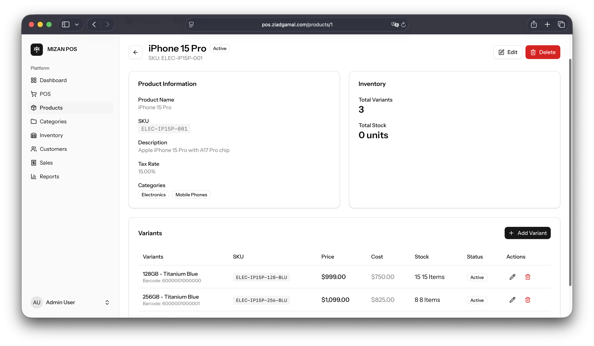
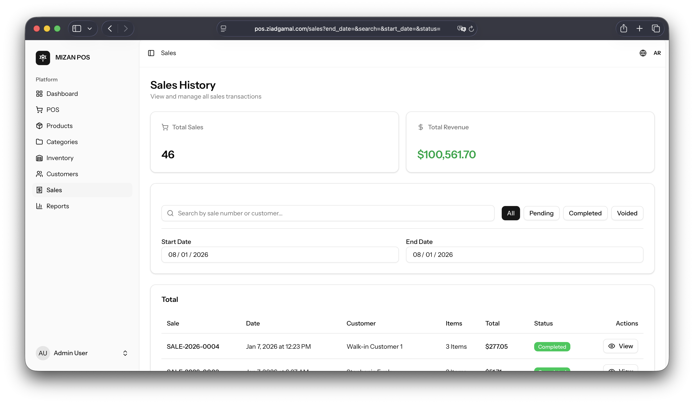
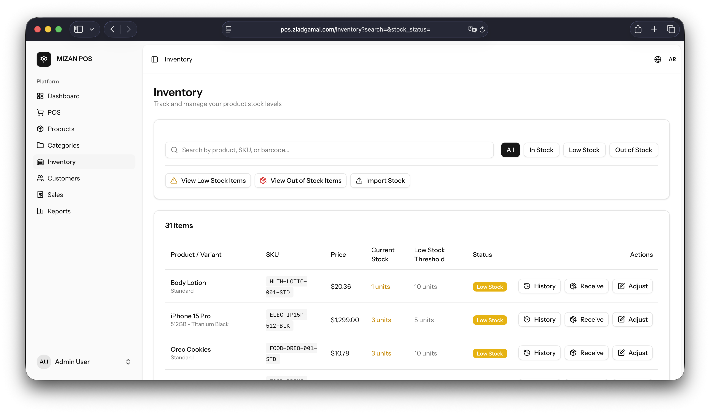
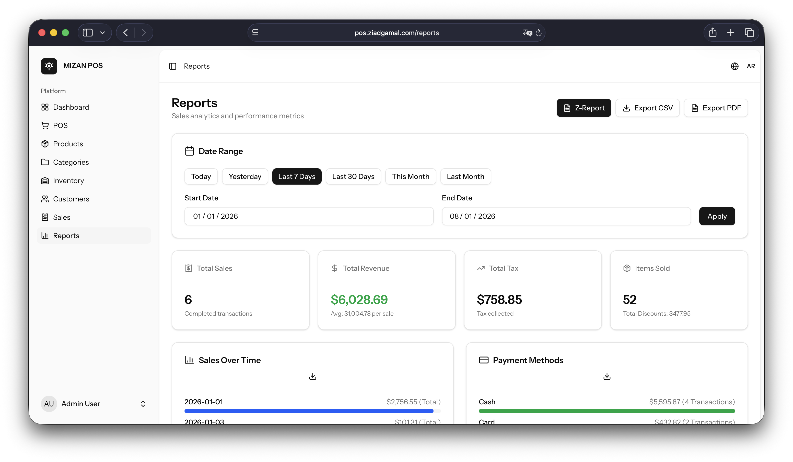
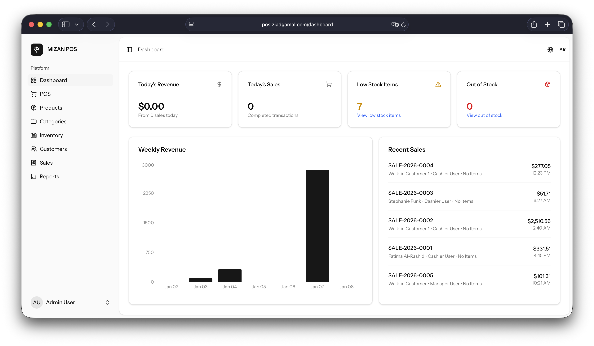
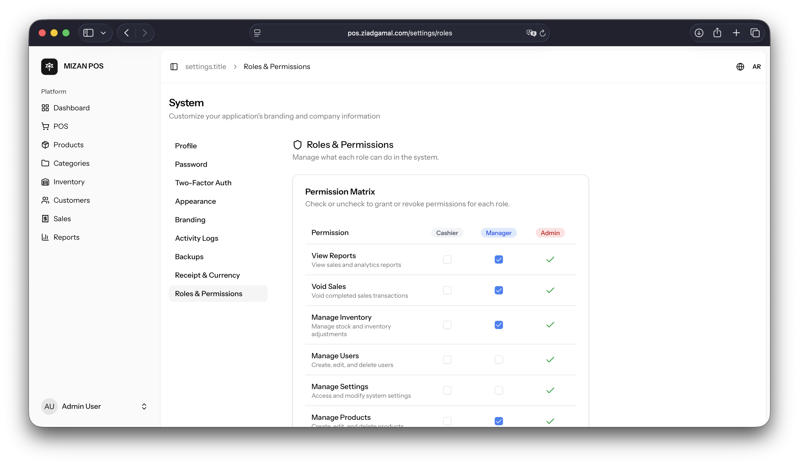

# Mizan POS
**Point of Sale web app (Laravel + Inertia React)**

A monolithic Point of Sale (POS) web app for small and mid-sized retail shops: inventory with variants, sales with returns and voids, reports, and multi-role staff management. Checkout runs inside database transactions.

**Developed by:** [Ziad Gamal](https://ziadgamal.com) - Backend Developer

---

## Business Impact

What it is built to solve for small retail shops:

*   **Consistent stock**: checkout, void and return each run in one database transaction, and every stock movement is written to an append-only stock ledger.
*   **Fast checkout**: a React interface served through Inertia.js, so the POS screen works without full page reloads.
*   **Reports**: Z-Reports, sales reports with PDF export, and low and out-of-stock alerts.

---

## Key Features

### Turbo-Charged POS Interface
*   **Speed**: Built with React & Inertia.js for instant interactions.
*   **Flexibility**: Product search by name, SKU or barcode.

### Smart Inventory Management
*   **Stock history**: `StockLedger` table tracks every single movement (Sales, Returns, Adjustments).
*   **Variants**: Products with variants, each with its own stock and price.
*   **Alerts**: Low-stock and out-of-stock views.

### Financial Intelligence
*   **Z-Reports**: End-of-day sales summary, printable and exportable to PDF.
*   **Dashboard**: Sales charts built with Recharts.
*   **Export**: PDF reports and inventory import by CSV.

---

## Technical Stack

| Domain       | Technology                          |
| :----------- | :---------------------------------- |
| **Backend**  | Laravel 12 (PHP 8.2+)               |
| **Frontend** | React 19, TailwindCSS 4, Inertia.js |
| **Database** | MySQL 8.0 (SQLite for local dev)    |
| **DevOps**   | Nginx on a VPS, GitHub Actions (lint and tests) |

---

## Gallery

### Dashboard & Analytics
The command center for business owners.

### The Point of Sale (POS)
Streamlined checkout interface with hold cart and barcode support.

### Sales History
Detailed transaction logs with one-click returns.

### Inventory Management
Real-time stock tracking and low-stock alerts.

### Reporting Engine
Visual financial reports (Daily, Weekly, Monthly).

### Settings & Configuration
Granular control over taxes, receipts, and system behavior.

### Role Management
Secure RBAC for Cashiers, Managers, and Admins.

---

## Deployment

See [docs/DEPLOYMENT_GUIDE.md](docs/DEPLOYMENT_GUIDE.md) for a VPS setup with Nginx, PHP-FPM and MySQL.

---
[Contact Developer](https://ziadgamal.com)
