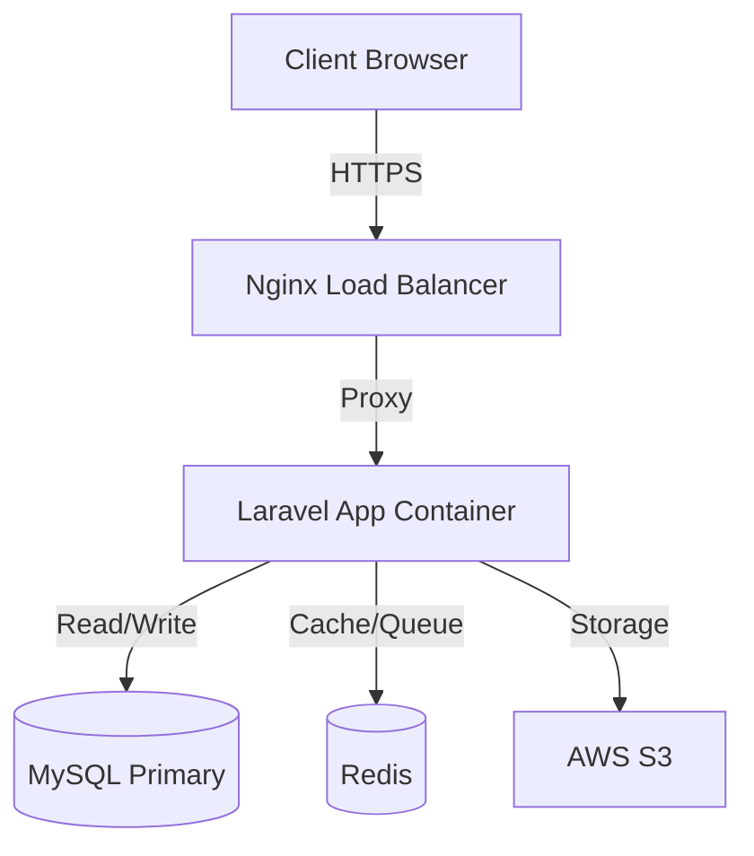

# System Architecture

## Overview
Mizan POS follows a **Monolithic Architecture** with a clear separation of concerns (SoC) between the Presentation Layer (Vue/React via Inertia) and the Domain Layer (Laravel).

## Data Model

### Key Entities
-   **`User`**: System actors (Admin, Cashier).
-   **`Product`**: The base item (e.g., "T-Shirt").
-   **`Variant`**: Specific SKUs (e.g., "T-Shirt Red XL").
-   **`StockLedger`**: Immutable record of logic inventory changes.
-   **`Sale`**: The header record for a transaction.
-   **`SaleLine`**: Individual items within a transaction.

## Design Patterns

### 1. Service Layer
Business logic is extracted from Controllers into Services (e.g., `SaleService`, `InventoryService`). This allows the same logic to be reused by:
-   Web Controllers (GUI)
-   API Controllers (Mobile App)
-   Console Commands (Bulk Imports/Automations)

### 2. Observer Pattern
Model Observers are used to trigger side effects without cluttering the creation logic.
-   *Example*: When a `Sale` is marked as `completed`, the `SaleObserver` might trigger a `DailySalesUpdated` event.

### 3. Policy Pattern (Authorization)
Laravel Policies enforce RBAC.
-   `viewAny`: Can the user see the list?
-   `create`: Can they add a new item?
-   `void`: Special permission for Managers to void sales.
